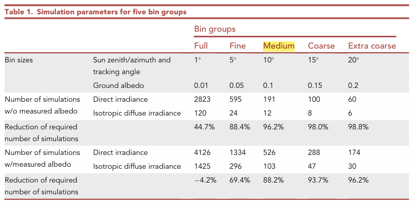

```{r setup, include=FALSE}
knitr::opts_chunk$set(message=FALSE,warning=FALSE, cache=TRUE)
```

# **Microclimate modelling**

## **Energy**

2026 | 10 | 02 Last compiled: `r Sys.Date()`

Surface energy balance equation:

$$R_n = H + LE + G$$

where $R_n$ is net radiation ($\text{W m}^{-2}$), $H$ is sensible heat flux ($\text{W m}^{-2}$), $LE$ is latent heat flux ($\text{W m}^{-2}$), $G$ is soil heat flux ($\text{W m}^{-2}$).

## **Water**

2026 | 10 | 02 Last compiled: `r Sys.Date()`

Penman-Monteith equation:

$$\lambda ET = \frac{\Delta (R_n - G) + \rho_a c_p \frac{(e_s - e_a)}{r_a}}{\Delta + \gamma \left(1 + \frac{r_s}{r_a}\right)}$$

Where $ET_0$ is reference evapotranspiration (mm/day), $R_n$ is net radiation, $G$ is soil heat flux density, $\Delta$ is the slope vapor pressure curve, and $\gamma$ is the psychrometric constant.

## **Temperature**

2026 | 10 | 02 Last compiled: `r Sys.Date()`

TBC

# **Radiation modelling**

This part will mainly in literature review and RQ3.

## **Radiance**
2026 | 10 | 05 Last compiled: `r Sys.Date()`

## **Irradiance**

**View factor models**: models based on view or shape factors are often employed to estimate the rear surface irradiance, low computational demand and simplify.

**Ray tracing models**: Monte Carlo Ray Tracing, it models light transport achieving detailed and realistic results but requiring rather computationally expensive processes.

**A study compare VF and RT**

Ernst et al. (2024) [Modelling bifacial irradiance – Step-by-step comparison and validation of view factor and ray tracing models](https://www.sciencedirect.com/science/article/pii/S0306261924009577)

    VF model: Jäger et al.’s in-house model (2D, analytical).
    
    RT model: Ernst et al.’s own object-oriented Monte Carlo ray tracing framework (from their 2021 iScience paper).
    
    Faiman model (adapted): used for cell temperature.
    
    Computing: 256 virtual CPUs on the Nectar Research Cloud and the National Computational Infrastructure Australia. VF takes about 15 min on a single CPU. RT 256 virtual CPUs, runtime ranges from 20 min for the simplest model to 730 min for the most detailed.
    
    Performance: Front 2 methods similar; Rear RT better. Reason: 支架，邊框導致VF高估光伏板背面光照。

Ernst et al. (2022) [Accelerating the simulation of annual bifacial illumination of real photovoltaic systems with ray tracing](https://www.sciencedirect.com/science/article/pii/S2589004221016680)

    Problem: Ray tracing is slow, and a full year has 5,326 timesteps. Running one simulation per timestep is too expensive.

    Solution: Group timesteps with similar conditions into bins. **Simulate one case per bin (at the bin’s mean value) and reuse the result for every timestep in that bin**.

{width=100%}


# **Crop modelling**

# **PV modelling**