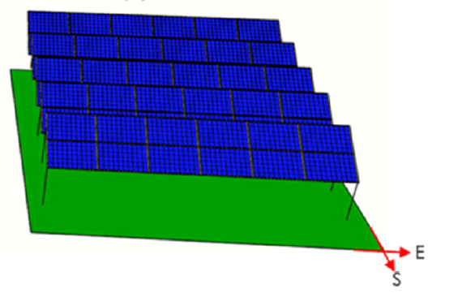
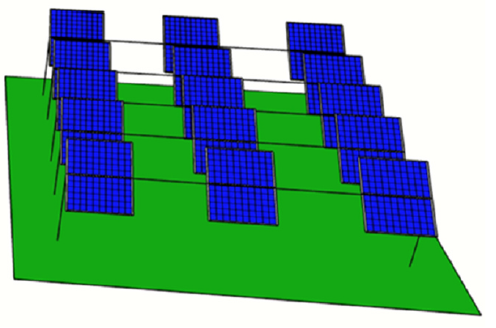
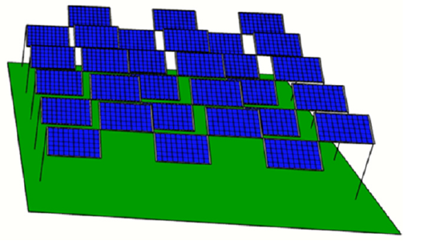

```{r setup, include=FALSE}
knitr::opts_chunk$set(message=FALSE,warning=FALSE, cache=TRUE)
```

# **AV system architectures**

**Fixed AV**: include ground-mounted, elevated (stilt-mounted), rooftops, and greenhouse-integrated configurations. Tilt and orientation are constant, with crop exposure determined mainly by panel spacing and mounting height. Elevated designs enhance machinery access and light distribution.

## **General configurations**

Key parameters—panel height (2–8 m), spacing (3–12 m), shading ratio (0.2–0.8), and tilt (0–45◦), to regulate light distribution, microclimate, crop responses.

**Dynamic AV**: single—or dual-axis tracking systems that adjust panel orientation in real time, enhancing PV yield while dynamically adjusting shading patterns.  Higher capital costs, increased mechanical complexity, and greater maintenance requirements.

## **Tracking strategies**

**Sun tracking**: The standard operation of the solar tracker, designed to maximize energy output

**Anti tracking**: The inverse of sun tracking, aimed at maximizing ground irradiance or minimizing solar irradiation interception by the PV system.

**Scheduled tracking**: A hybrid strategy that alternates between sun tracking and anti tracking throughout the day. For example, between 11am to 3pm use sun tracking and remaining hours use anti tracking. <span style="color:blue">This is to avoid midday hottest and most irradiated hours that incoming light may exceed the crop's usable range</span>. 

**Daily light integral tracking**: Initially follows the anti tracking strategy until the crop's required DLI is met, then switches to sun tracking for the remainder of the day prioritizing energy conversion (light for crop use first and then energy).

**Knee point tracking**: It chooses the optimal tilt angle based on the ambient temperature in the field that is derived out of the optimal PAR of the LRC using the KP.

*Note: I'm really interested with different tracking strategies, especially those prioritize crop light requirements (and not so many research papers about this - there is a big research gap). But I read an Australian review paper and realize Australian farmers are more care about general configurations, like panel height, row spacing, material...I need to consider what farmers need, not just my interests. Horticulture: wine grape; two materials: semi-transparent and bifacial; if tracking, sun tracking, scheduled tracking, daily light integral; if fixed, height, row spacing, tilt angle; grape data: from field observation, or CSIRO, or APSIM.*

# **Panel materials**

**Conventional c-Si**: single-sided monocrystalline or polycrystalline silicon modules, characterised by a single active surface exposed to direct solar radiation. <span style="color:blue">Usually moderate to high shading</span>. Common in tracking systems.

**Bifacial PV**: two active surfaces capable of absorbing not only direct and diffuse radiation, but also that reflected from the ground. <span style="color:blue">Usually low to moderate shading in vertical; moderate to high shading in tilt</span>. Common in horticulture.

**Semi-tranparent PV**: transmit a significant amount of PAR, while filtering out wavelengths that cannot be used by plants and converting them into electricity. <span style="color:blue">Usually low to moderate shading</span>.

**Concentrating PV**: convey solar radiation to high-efficiency multi-junction cells, allowing the diffuse component of the radiation to pass through to the plants. <span style="color: blue">Designed for low crop light penaty</span>.

# **Panel distribution**

Continuous straight-line (standard):一整條連續不間斷的直綫。光照均匀度較低，發電力度大。板下光照梯度劇烈，不適合高光需求作物。

Checkerboard: 隔一空一，交錯分佈。隨著太陽移動，板下接受的光照更加散射和均匀，改善作物的光照均匀度。

Dash-line: 鋪設一段，留空一段。eg安裝2-3塊板，空出1-2塊板。軸綫方向上有透光空隙，陽光能直射或散射入地面。

{width=25%}
{width=25%}
{width=25%}

# Land equivalent ratio (LER)

LER formula:

$$LER = \frac{Y_{cr,AV}}{Y_{cr,ref}}(1 - LL) + \frac{Y_{e,AV}}{Y_{e,ref}}$$

Where $Y_{cr,AV}$ is the crop yield (t/ha) under the AV system, $Y_{cr,ref}$ is the crop yield in the unshaded reference system (t/ha), $Y_{e,AV}$ is the AV energy yield (MWh/ha) and $Y_{e,ref}$ is the energy yield from the reference or GMPV system (MWh/ha). LL is the land loss and is attributed to the crop, as it represents the percentage of land under the AV array not used for crop cultivation due to the presence of the support structures. 
