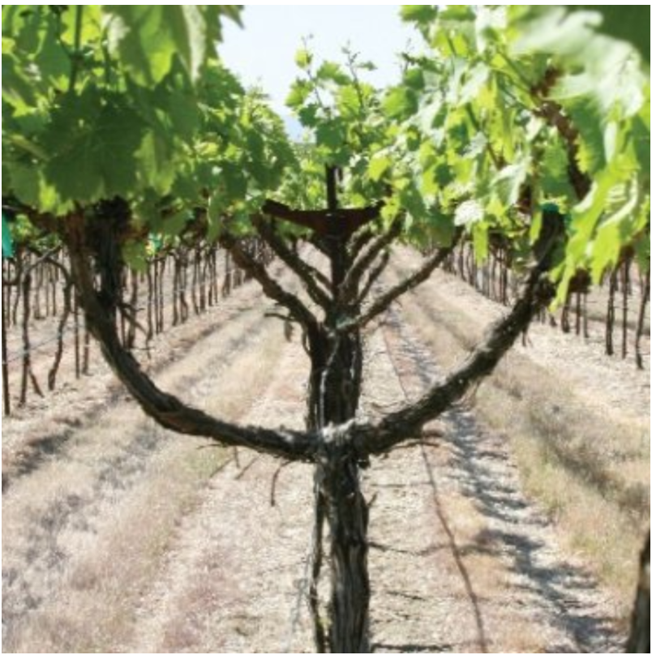
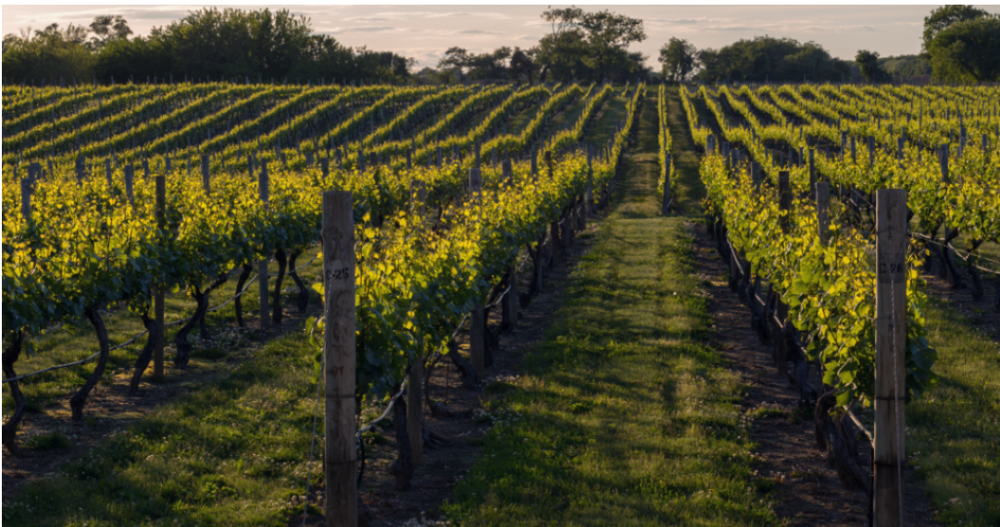

```{r setup, include=FALSE}
knitr::opts_chunk$set(message=FALSE,warning=FALSE, cache=TRUE)
```

# **Vineyards**

**Trellis system**

**Split canopy**: 將原本過於濃密，互相遮擋的葡萄樹冠拆分成兩個或多個獨立的空間區域。用於改善通風與光照，減少病害。包括水平分割與垂直分割。

**Lyre System**： The Lyre system is in fact another split-canopy design, but instead it trains the vines outward into a “U” shape. This system is particularly effective in managing vine vigor and controlling excessive growth.

Balanced Growth: By spreading the vines outward, the Lyre system consequently prevents overcrowding and promotes balanced growth.

Improved Grape Quality: The open canopy enhances sunlight exposure and air circulation, leading to better fruit quality.

Reduces Disease: The system’s structure minimizes humidity within the canopy, reducing the likelihood of disease.

{width=25%}

**Double vertical**: Split canopy的一種。樹冠在垂直方向上分上下兩層。Including upward shoot positioning and downward shoot positioning.不需要額外的行寬，適用於標準行距的葡萄園。

Optimal Sunlight Exposure: VSP ensures that all shoots receive even sunlight, therefore creating uniform ripening.

Improved Air Circulation: By keeping the canopy open and well-ventilated, VSP reduces the risk of fungal diseases.

Ease of Management: This system simplifies vineyard tasks such as pruning, canopy management, and harvesting.

Cooler climates

Varieties like Pinot Noir, Chardonnay, and Riesling

{width=25%}

