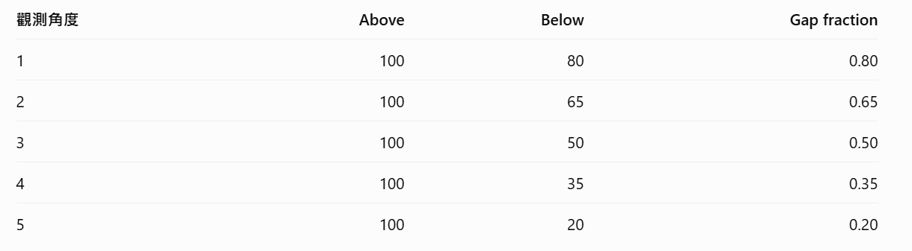
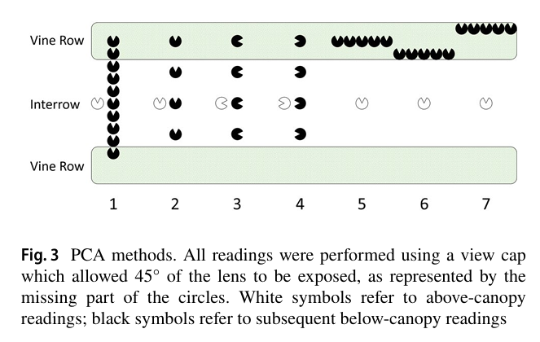
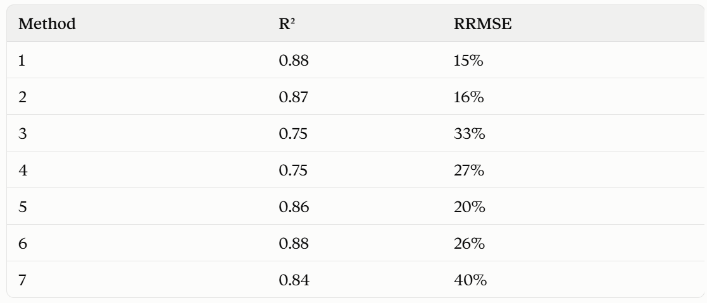

```{r setup, include=FALSE}
knitr::opts_chunk$set(message=FALSE,warning=FALSE, cache=TRUE)
```

# **Plant conopy analyzer (PCA)**

LI-COR plant canopy analyzer: LAI-2200 or LAI-2200C. LAI-2200C is more advanced than LAI-2200. Main advantage of LAI-2200C is its ability to take readings under clear sky and the option to enter scattering correction inputs.

Primary Purpose: Measures Leaf Area Index (LAI)—the ratio of leaf surface area to ground area—which is a crucial biophysical parameter for modeling evapotranspiration, photosynthesis, light interception, and crop growth.

Above & Below Canopy Measurements:

&emsp;&emsp;$A$ Reading: Taken in an open clearing or above the plant canopy to measure total incoming sky diffuse radiation.

&emsp;&emsp;$B$ Reading: Taken below or within the canopy.

&emsp;&emsp;The instrument calculates transmittance ($T = B / A$) across the 5 view angles to determine how much gap space exists. 

它不拍照，而是用五個環形探測器，把整個冠層的光線遮擋情況轉換成數據,測量不同方向有多少光線穿過樹冠。儀器將這五組數據結合起來，利用數學模型估算 LAI。

{width=75%}

View Restrictors: To block out the user operator, neighboring rows, or unwanted sun glare, field-of-view caps ($45^\circ, 90^\circ, 180^\circ, 270^\circ$) can be placed over the fisheye lens.

## Study using PCA measurement: Example 1

White et al., 2019: [Determining a robust indirect measurement of leaf area index in California vineyards for validating remote sensing-based retrievals](https://link.springer.com/article/10.1007/s00271-018-0614-8)

    Conducted LAI measurement in 4 vineyards with regular basis (but haven't mentioned what's the frequency). 5 transects, and 5 measurements for each transect (5 vine rows, 1 row 1 measurement).

    Include above canopy reading and below canopy reading.

    Used 315 cap and the 45 window was pointed away from the operator (ensure the operator out-of-view).

    Avoid 2-h window around solar noon, measured in the morning.
    
    Measurements were averaged within transects to produce canopy LAI estimate.
    

7 methods are used, show as follows:

{width=75%}

Measurement results and accuracy:

{width=75%}

*在我的實驗中，我將考慮method 2.原因是較少（4次）的測量可以得到與較多（10次）測量類似的結果。使用315 cap. 但由於Bickley的葡萄藤長得較矮，我需要重新考慮transect設計。*

## Study using PCA measurement: Example 2

Kang et al., 2022 [Evaluation of satellite Leaf Area Index in California vineyards for improving water use estimation](https://link.springer.com/article/10.1007/s00271-022-00798-8)

這篇文對White et al., 2019的文進行了補充。
    
    LAI measurments were conducted during intensive data collection periods (IOPs). 1 Flowering stage between at April and early May; 2 Berry development satge in early to mid June when vines rapidly grow; 3 Fully developed vine canopy in mid-July to early August; 4 Grape harvest in late SDepeember (USA). IOPs were  scheduled to coincide with Landsat overpasses. 
    
     Vine LAI was determined by acquiring below canopy readings at approximately 30 cm above the ground (above cover crop).
    
    In 2013-2016, they used parallel configuretion, and found this method underestimate LAI.
    
    In 2016, White et al., 2018 found sensor view direction perpendicular to the vine row has the yield the most consistent results with destructive measurements.
    
*結合以上這兩篇文，我將使用PCA sensor view direction perpendicular to the vine row. Landsat每16天revisit一次，推測sample frequency 是16天一次。*

Australia wine grape growing cycle:

&emsp;&emsp;Winter (June – August) — Dormancy & Pruning

&emsp;&emsp;<span style="color:blue">Spring (September – November) — Budburst & Flowering</span>

&emsp;&emsp;<span style="color:blue">Summer (December – February) — Canopy Growth & Véraison</span>

&emsp;&emsp;Autumn (March – May) — Harvest (Vintage) & Leaf Drop

*基於澳洲葡萄的生長季，我將在2027年9月份到2028年2月份期間，每兩周進行一次LAI measurement.*

# **Digital Hemispherical Photography (DHP)**

魚眼鏡頭拍攝整個半球天空，分析天空與冠層的像素比例。

*在生長季初期，葉子比較少，無論用哪種儀器都會不可避免地有樹幹遮擋光綫，這測到的LAI算什麽？*